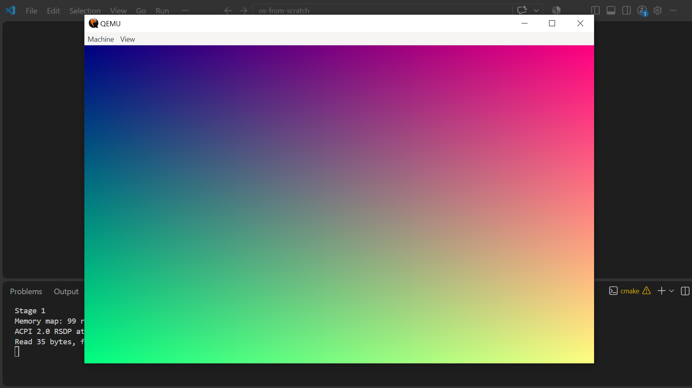

# os-from-scratch 💿

Welcome! This is an open learning resource and playground for building a 64-bit operating system from scratch in freestanding C, booting natively via modern **UEFI (Unified Extensible Firmware Interface)** on x86_64 architecture.

Whether you are here to learn or to build upon this code, feel free to explore, experiment, and use this repository for your own journey!

---

### 🧠 What We Are Building

This project explores low-level development by bypassing legacy BIOS entirely. The code establishes a modern foundation by:

- Mapping custom standalone header definitions matching the official UEFI specifications.
- Launching a custom UEFI application directly from a GPT/FAT32 volume.
- Retrieving physical system memory structures, graphics framebuffers, and ACPI tables.
- Transitioning execution safely into x86_64 Long Mode before handoff.

---

### ⚡ Quick Start & Run

Get the project compiled and booting in a virtual system by executing these three simple setup commands:

```bash
# Initialize the CMake build system layout
cmake --preset uefi

# Cross-compile the code into a valid .EFI binary
cmake --build --preset uefi

# Boot the custom application straight into QEMU emulation
cmake --build --preset uefi --target run
```

---

### 🗺️ Documentation & Roadmaps

To look deeper into current milestones, review individual checklists, or learn about toolchain configurations, follow our live progress tracker:

👉 See detailed architectural insights in **[PROGRESS.md](./docs/PROGRESS.md)**
