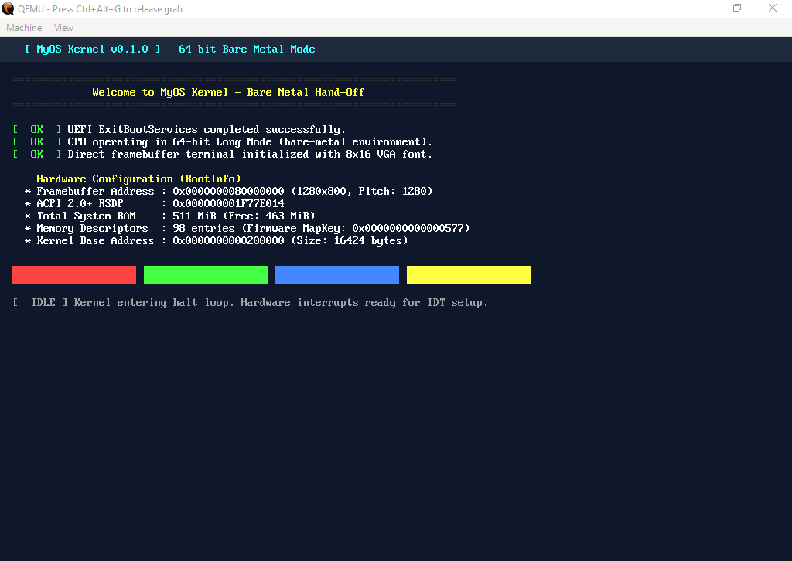

# os-from-scratch

A minimal 64-bit operating system for x86_64, booting natively via UEFI without legacy BIOS or GRUB dependencies. Implemented in freestanding C using Clang, LLD, and Ninja.



## Overview

The project consists of two primary binaries:

1. **Bootloader (`BOOTX64.EFI`)**: A PE32+ UEFI application that probes system hardware (ACPI 2.0+ RSDP, memory map, GOP framebuffer), parses and loads the 64-bit ELF kernel image, exits boot services, and transfers control via a unified handoff structure (`BootInfo`).
2. **Kernel (`kernel.elf`)**: A freestanding x86_64 ELF binary loaded at 2 MiB physical. Implements direct linear framebuffer rendering (RGB and BGR formats), an 8x16 VGA font engine, and a scrolling text console.

## Project Structure

```text
├── boot_info.h       # Bootloader-to-kernel handoff contract
├── CMakeLists.txt    # Unified build configuration for bootloader and kernel
├── CMakePresets.json # Ninja build presets (debug / release)
├── CONTRIBUTING.md   # Contribution guidelines and coding standards
├── LICENSE           # GNU General Public License v2
├── main.c            # UEFI bootloader, hardware probing, and ELF64 loader
├── include/uefi/     # Standalone UEFI 2.x specification headers
├── kernel/
│   ├── kernel.c      # Kernel entry point (kernel_main)
│   ├── screen.c      # Framebuffer terminal and primitive rendering
│   ├── font.h        # 8x16 bitmap console font
│   ├── string.c      # Freestanding memory routines (memcpy, memset, etc.)
│   └── linker.ld     # Kernel linker script (base at 0x00200000)
└── docs/
    └── PROGRESS.md   # Current milestone status and technical notes
```

## Prerequisites

- **Clang** (with `lld` / `lld-link`)
- **CMake** (>= 3.20) and **Ninja**
- **QEMU** (`qemu-system-x86_64`) with OVMF firmware

## Building and Running

### 1. Build via CMake Presets (Recommended)

```powershell
# Configure Ninja build directory with Clang toolchain
cmake --preset ninja-debug

# Compile kernel.elf, bootx64.efi, and stage the ESP directory
cmake --build --preset ninja-debug

# Clean rebuild
cmake --build --preset ninja-debug --clean-first
```

### 2. Manual CMake Invocation

```powershell
cmake -B build/debug -G Ninja -D CMAKE_C_COMPILER=clang
cmake --build build/debug
```

### 3. Emulation (QEMU)

Launch directly through the CMake target (auto-detects OVMF firmware):

```powershell
cmake --build build/debug --target run
```

Or invoke QEMU manually:

```powershell
qemu-system-x86_64 `
  -drive if=pflash,format=raw,readonly=on,file="C:/Program Files/qemu/share/edk2-x86_64-code.fd" `
  -drive file=fat:rw:build/debug/esp,format=raw `
  -net none `
  -serial stdio
```

### 4. Binary Inspection & Debugging

Verify ELF segment layout, physical base (`0x200000`), and entry point:

```powershell
# Inspect ELF headers and PT_LOAD segment alignment
llvm-readelf -h -l build/debug/kernel.elf

# Disassemble kernel entry point
llvm-objdump -d --no-show-raw-insn build/debug/kernel.elf

# Inspect UEFI PE32+ bootloader headers
llvm-objdump -p build/debug/esp/EFI/BOOT/BOOTX64.EFI
```

Attach GDB to QEMU via port `1234`:

```powershell
# Terminal 1: Launch QEMU paused at reset vector
qemu-system-x86_64 `
  -drive if=pflash,format=raw,readonly=on,file="C:/Program Files/qemu/share/edk2-x86_64-code.fd" `
  -drive file=fat:rw:build/debug/esp,format=raw `
  -net none `
  -s -S

# Terminal 2: Connect GDB and load kernel symbols
gdb -ex "target remote localhost:1234" -ex "symbol-file build/debug/kernel.elf"
```

The build system automatically deploys `BOOTX64.EFI` to `build/debug/esp/EFI/BOOT/` and `kernel.elf` to `build/debug/esp/` for direct FAT volume emulation.

## Status & Roadmap

See [docs/PROGRESS.md](docs/PROGRESS.md) for milestone tracking, handoff invariants, and upcoming kernel tasks (GDT, IDT, PMM, Paging).

## License & Contributing

Licensed under the [GNU General Public License v2](LICENSE). Contributions welcome — please review [CONTRIBUTING.md](CONTRIBUTING.md) before submitting patches or pull requests.
